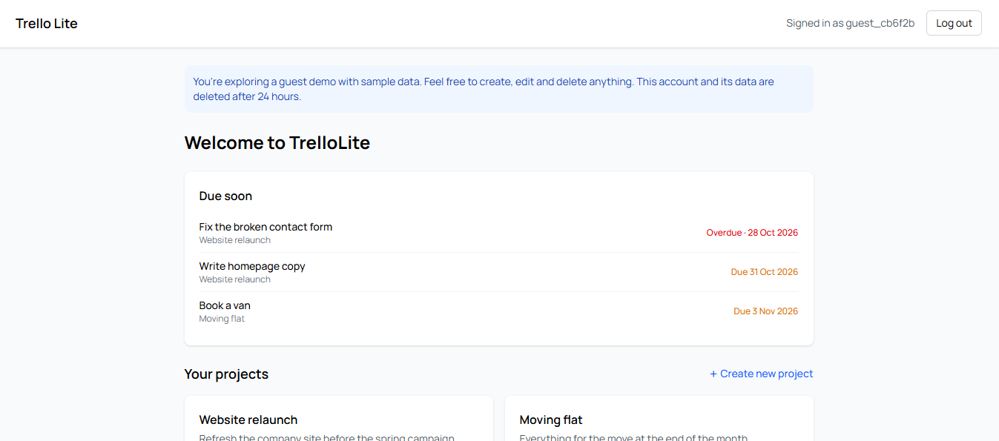

# Trello Lite

A full stack task management app for organising projects and tasks, built with a React and TypeScript frontend, a Spring Boot REST API and a PostgreSQL database.

**Live demo:** [trello-lite-anousha.netlify.app](https://trello-lite-anousha.netlify.app/)



Click **Try as guest** on the login page to explore with sample data, no sign up needed. The backend runs on a free tier that sleeps when idle, so the first request can take up to a minute.

## Features

- Secure registration and login with JWT authentication
- Protected routes, so only signed in users can access their dashboard
- Create projects and view them on a personal dashboard
- Add tasks to a project, with title, description and optional deadline
- Track task status (To Do, In Progress, Done) from a dropdown
- Edit tasks inline and delete them with a confirmation prompt
- Deadline alerts that flag overdue tasks in red
- Due soon section on the dashboard for overdue and upcoming tasks
- Rename and delete projects
- Ownership checks, so users can only see and change their own projects and tasks
- One click guest demo: each visitor gets their own temporary account with sample data, removed after 24 hours by a scheduled cleanup job

## Tech Stack

| Layer | Technologies |
| --- | --- |
| Frontend | React, TypeScript, Vite, Tailwind CSS, React Router, Axios |
| Backend | Java, Spring Boot, Spring Security, Spring Data JPA |
| Database | PostgreSQL (H2 in memory database for tests) |
| Auth | JSON Web Tokens (JWT) |
| Testing | @SpringBootTest, MockMvc, Postman |

## How It Works

The React frontend talks to the Spring Boot API over HTTP. On login, the API returns a JWT, which the frontend stores and attaches to every request through an Axios interceptor. Spring Security validates the token on each request through a custom JWT filter, and expired or invalid tokens return a 401 so the user is sent back to the login page.

Errors are handled centrally with `@RestControllerAdvice` and custom exceptions, so the API always returns clear, consistent JSON error responses.

## API Endpoints

<details>
<summary>Show all endpoints</summary>

### Auth
| Method | Endpoint | Description |
| --- | --- | --- |
| POST | `/api/auth/register` | Create an account |
| POST | `/api/auth/login` | Log in and receive a JWT |
| POST | `/api/auth/guest` | Create a temporary guest account with sample data |

### Projects
| Method | Endpoint | Description |
| --- | --- | --- |
| GET | `/api/projects` | List projects |
| GET | `/api/projects/{id}` | Get a single project |
| POST | `/api/projects` | Create a project |
| PUT | `/api/projects/{id}` | Rename a project or change its description |
| DELETE | `/api/projects/{id}` | Delete a project and its tasks |

### Tasks
| Method | Endpoint | Description |
| --- | --- | --- |
| GET | `/api/tasks/project/{projectId}` | List tasks in a project |
| POST | `/api/tasks` | Create a task |
| PUT | `/api/tasks/{id}` | Edit a task's title, description or deadline |
| PUT | `/api/tasks/{id}/status` | Update a task's status |
| DELETE | `/api/tasks/{id}` | Delete a task |
| GET | `/api/tasks/upcoming` | Overdue tasks and tasks due in the next 7 days |

## Deployment

| Part | Hosted on |
| --- | --- |
| Frontend | Netlify |
| Backend | Render, built from the backend Dockerfile |
| Database | Neon (managed PostgreSQL, London) |

</details>

All configuration (database credentials, JWT secret, allowed CORS origins) is supplied through environment variables, so no secrets live in the repository. The whole stack can also run locally with `docker compose up --build`.

## Running Locally

### Prerequisites
- Java 17 or later
- Node.js and npm
- PostgreSQL

### Backend
1. Create a PostgreSQL database for the app.
2. In `backend/src/main/resources/`, copy `application.properties.example` to `application.properties` and fill in your database details and JWT secret.
3. From the `backend` folder, run:
   ```bash
   mvn spring-boot:run
   ```
   The API runs on `http://localhost:8080`.

### Frontend
1. From the `frontend` folder, run:
   ```bash
   npm install
   npm run dev
   ```
2. Open `http://localhost:5173`.

## Testing

Integration tests use `@SpringBootTest` with MockMvc and an in memory H2 database, covering authentication, projects and tasks through the real JWT security filter chain.

```bash
cd backend
mvn test
```
